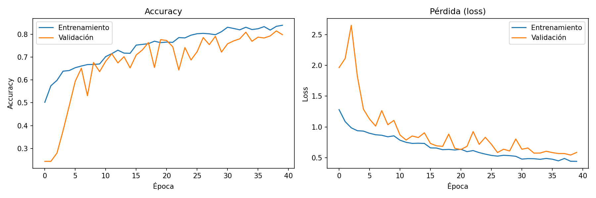
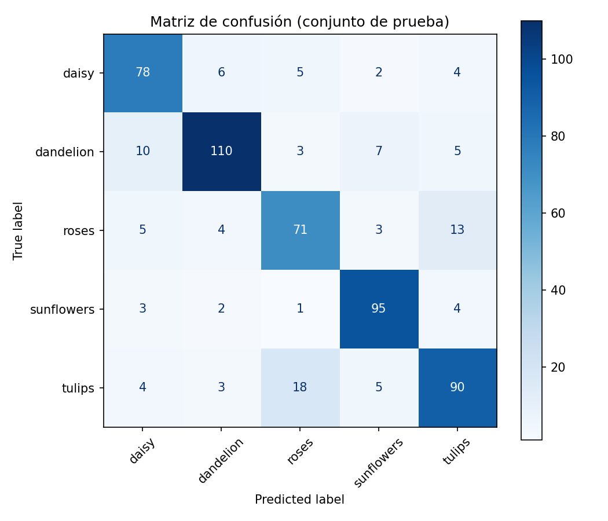
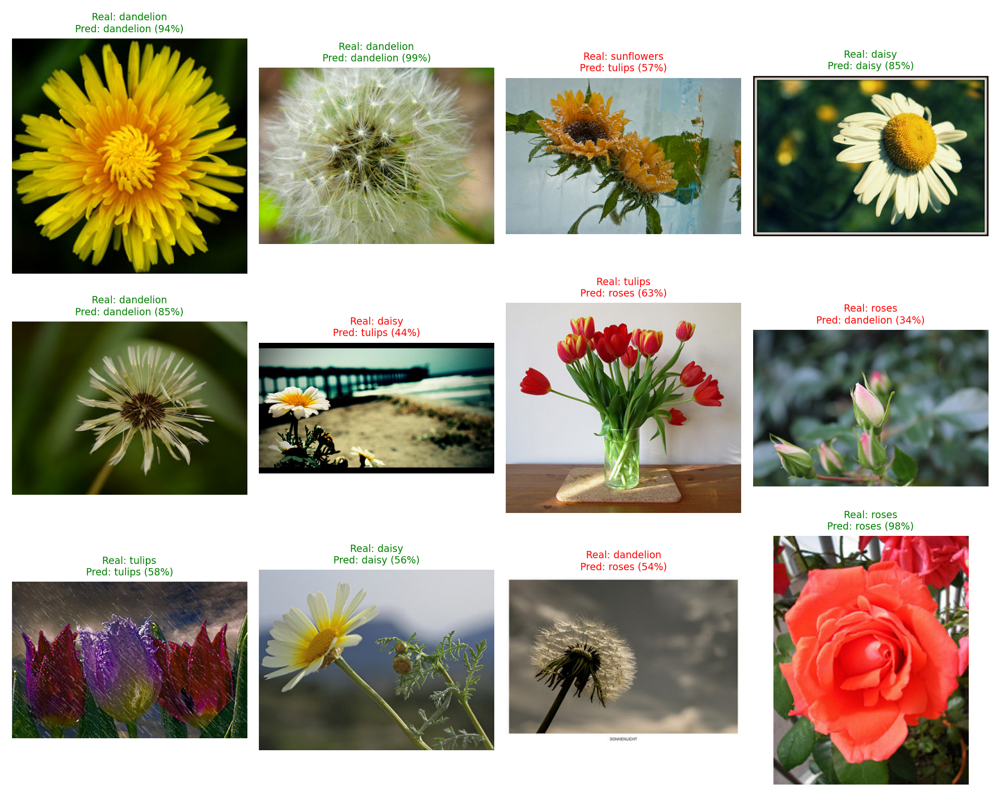

# 🌼 Clasificación de flores con una CNN

Proyecto de Deep Learning: una Red Neuronal Convolucional (TensorFlow/Keras) entrenada desde cero para clasificar imágenes en 5 tipos de flores, con una aplicación Streamlit para hacer predicciones.

## Dataset
**TF Flowers** (~3.670 imágenes, 5 clases: `daisy`, `dandelion`, `roses`, `sunflowers`, `tulips`).
Se descarga automáticamente desde `storage.googleapis.com/download.tensorflow.org` (no se versiona en Git).

## Estructura del repositorio
```
├── notebooks/experimentacion.ipynb   # Experimentación completa (Colab): EDA, preprocesamiento,
│                                     # augmentation, entrenamiento, métricas, matriz de confusión, 12 predicciones
├── src/
│   ├── data.py        # descarga, división 70/15/15 estratificada, pipeline tf.data
│   ├── model.py       # arquitectura CNN + data augmentation + normalización
│   ├── train.py       # entrenamiento y evaluación por línea de comandos
│   ├── evaluate.py    # gráficas, matriz de confusión, reporte, visualización de predicciones
│   └── predict.py     # carga del modelo y predicción (módulo + CLI)
├── app/streamlit_app.py              # aplicación web
├── models/cnn_flores.keras           # modelo entrenado
├── models/class_names.json           # nombres de clases
├── reports/                          # curvas, matriz de confusión, predicciones, reporte de métricas
└── requirements.txt
```

## Metodología
1. **Preprocesamiento:** redimensionado a 180×180 y normalización `[0,255] → [0,1]` (capa `Rescaling` dentro del modelo).
2. **División:** 70 % train / 15 % validación / 15 % test, estratificada y con semilla fija.
3. **Data Augmentation** (solo en entrenamiento): flip horizontal, rotación, zoom y contraste.
4. **Modelo:** 4 bloques `[Conv-BN-ReLU ×2 + MaxPool]` (32→256 filtros) + GAP + Dense(128) + Dropout(0.5) + Softmax.
5. **Entrenamiento:** Adam, `EarlyStopping`, `ReduceLROnPlateau` y `ModelCheckpoint`.
6. **Evaluación:** accuracy, precision/recall/F1 por clase y matriz de confusión sobre el conjunto de prueba.

## Resultados
> Completa esta sección tras entrenar (están en `reports/classification_report.txt`).

| Métrica | Valor |
|---|---|
| Accuracy (test) | _XX %_ |





## Ejecución

### 1. Instalación
```bash
git clone <URL_DEL_REPOSITORIO>
cd cnn-flores
python -m venv .venv && source .venv/bin/activate   # Windows: .venv\Scripts\activate
pip install -r requirements.txt
```

### 2. Entrenar el modelo (opción A: línea de comandos)
```bash
python -m src.train --epochs 30
```
Genera `models/cnn_flores.keras`, `models/class_names.json` y los archivos de `reports/`.

### 2. Entrenar el modelo (opción B: Google Colab)
1. Sube el repositorio a GitHub y abre `notebooks/experimentacion.ipynb` en Colab (*Archivo → Abrir cuaderno → GitHub*).
2. Edita `REPO_URL` en la primera celda de código y activa la GPU.
3. Ejecuta todas las celdas. La última descarga `artefactos.zip` (modelo + reportes).
4. Descomprímelo en la raíz del repositorio y haz `git add` / `git commit` / `git push`.

### 3. Predicción por consola
```bash
python -m src.predict ruta/a/imagen.jpg
```

### 4. Aplicación Streamlit
```bash
streamlit run app/streamlit_app.py
```
Abre `http://localhost:8501`, sube una imagen y verás la clase predicha, su confianza y la distribución de probabilidades.

## Notas
- Las imágenes llegan al modelo en escala 0–255; la normalización está dentro del modelo, por lo que entrenamiento e inferencia son consistentes.
- La app indica "confianza baja" cuando la probabilidad máxima es < 60 %.
- Posibles mejoras: *transfer learning* (MobileNetV2/EfficientNet), ajuste de hiperparámetros, más datos.
